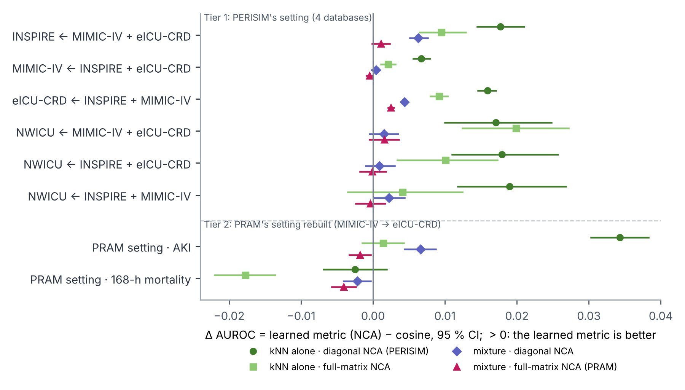

# Learned or fixed distance metrics for patient retrieval in ICU prediction models

**A pre-registered factorial study reconciling discordant findings.** Code, tests and aggregate results of the medRxiv preprint (link pending).

[](https://doi.org/10.17605/OSF.IO/3SBFG)
[](https://doi.org/10.17605/OSF.IO/P5CA3)
[](LICENSE)

## The question

PRAM (Jeong et al., 2026) found a fixed cosine distance better than a learned neighbourhood components analysis (NCA) metric for retrieval-augmented ICU models. PERISIM found a learned diagonal NCA metric better than cosine. The two pipelines differ in several factors at once. Which of them explain the discordance?

## In one sentence

PRAM's finding holds for its pipeline (neighbours correcting a frozen model, full-matrix NCA); when the k-nearest neighbours make the prediction and the NCA is diagonal, the learned metric beats cosine. The two findings are complementary.

## Design

Four factors, each with a PERISIM level and a PRAM level:

| Factor | PERISIM level | PRAM level |
| --- | --- | --- |
| U, use of the neighbours | standalone kNN prediction | mixture with the frozen model, p = (1 − a)·p_base + a·p_kNN |
| V, vote | smoothed count over distinct patients | inverse distance, 1/(d + 1e-6) |
| I, NCA implementation | diagonal NCA | scikit-learn full-matrix NCA |
| S, setting | landmarks, hypotension within 6 h, four databases | 42 first-24-h features, acute kidney injury and 168-h mortality |

- **Tier 1** crosses U, V and I in PERISIM's setting: INSPIRE, MIMIC-IV, eICU-CRD and NWICU, six destination units.
- **Tier 2** rebuilds PRAM's setting (MIMIC-IV → eICU-CRD) and crosses the same factors.
- Estimand: Δ AUROC (NCA − cosine) with bootstrap 95 % CIs; hypotheses and attribution rule registered before any run.

## Results

| | |
|---|---|
| Learned vs. cosine, PERISIM's pipeline | NCA better in all 6 Tier 1 units: Δ AUROC +0.0067 to +0.0190 |
| PRAM's Table S13 reproduced | With PRAM's pipeline in its rebuilt setting, cosine better: AKI −0.0018 (−0.0033 to −0.0003), mortality −0.0041 (−0.0057 to −0.0024) |
| Attribution | No single factor reverses the ordering in both tiers. Use and implementation together do: PRAM's levels remove the NCA advantage in 5 of 6 Tier 1 units; PERISIM's levels give NCA an advantage in PRAM's setting for AKI (+0.0343) and no difference for mortality |
| Vote | Changes Δ by at most 0.0007 |

<p align="center"></p>

## Repository

| Folder | Contents |
|---|---|
| [`src/perisim`](src/perisim), [`src/hypo`](src/hypo) | Shape-function encoding, diagonal NCA, kNN vote; the landmark pipeline that learns and freezes the metrics |
| [`config/`](config) | Settings (`hypo.yaml`: k = 50, 40 shape models, NCA, α grid) |
| [`scripts/`](scripts) | `posthoc_cosine.py` (Table 1), `pram_build.py` (PRAM's setting rebuilt), `pram_factors_t1.py` and `pram_factors_t2.py` (the two tiers), `posthoc_fixed_metric.py` (mutual-information metric used by both tiers), `nwicu_build.py` and `nwicu_transport.py` (NWICU units), `check_public_safety.py` |
| [`tests/`](tests) | Tests on synthetic data |
| [`docs/`](docs) | Pre-registration of the factorial study (`prereg_pram_factors.md`), of the NWICU units and of the landmark experiment; design and freeze record |
| [`results/`](results) | Aggregates only: `hypo_cosine` (Table 1) and `pram` (Tiers 1 and 2, with JSON) |
| [`figures/`](figures) | Figure 1, rebuilt from `results/pram` |

## Reproduce

The four databases are credentialed PhysioNet resources and must be obtained there. Nothing in this repository is patient-level.

```bash
# Python 3.11
pip install -e .                    # perisim and hypo (requirements-lock.txt for exact versions)
pytest -q                           # tests on synthetic data, no database needed

# Database paths in config/experiment.yaml (or PERISIM_WORKDIR)
export PERISIM_ARM=value
python -m hypo landmarks            # landmark tables
python -m hypo cv && python -m hypo final && python -m hypo external   # learn, freeze and transport the metrics
python scripts/nwicu_build.py && python scripts/nwicu_transport.py      # NWICU units
python scripts/posthoc_fixed_metric.py   # mutual-information metric
python scripts/posthoc_cosine.py         # Table 1
python scripts/pram_factors_t1.py        # Tier 1
python scripts/pram_build.py             # PRAM's setting from MIMIC-IV and eICU-CRD
python scripts/pram_factors_t2.py        # Tier 2
python figures/parse_fac.py && python figures/fig_fac.py   # Figure 1
python scripts/check_public_safety.py --all
```

## Limitations

PRAM's code is not available: Tier 2 is a reconstruction (about 30 % more stays, about twice the AKI prevalence in eICU-CRD and a stronger frozen logistic model than PRAM's), and that PRAM used scikit-learn's full-matrix NCA is our assumption. See the preprint and [`results/pram/README.md`](results/pram/README.md).

## Data and ethics

INSPIRE (Lim et al., 2024), MIMIC-IV (Johnson et al., 2023), eICU-CRD (Pollard et al., 2018) and NWICU (Moukheiber et al., 2024) were created with the approval of the review boards of their source institutions and are distributed by PhysioNet under credentialed access. No patient-level data are shared; results are aggregates with no cell under 10 patients.

## References

Jeong, I., Lee, T., Kim, B., Park, J.-H., Kim, Y., & Lee, H. (2026). *PRAM: Post-hoc retrieval augmentation adapts intensive care prediction models without retraining and can be shared across hospitals* (Version 2) [Preprint]. medRxiv. https://doi.org/10.64898/2026.04.03.26350132

Goldberger, J., Roweis, S., Hinton, G., & Salakhutdinov, R. (2004). Neighbourhood components analysis. In *Advances in Neural Information Processing Systems 17* (pp. 513–520). MIT Press.

## Licence

MIT. Ramsés Marrero García, Rosalía Cayuela and the AI Laboratory, Hospital Clínic de Barcelona.
